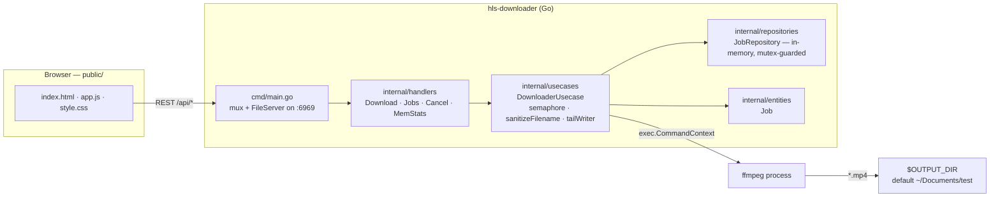
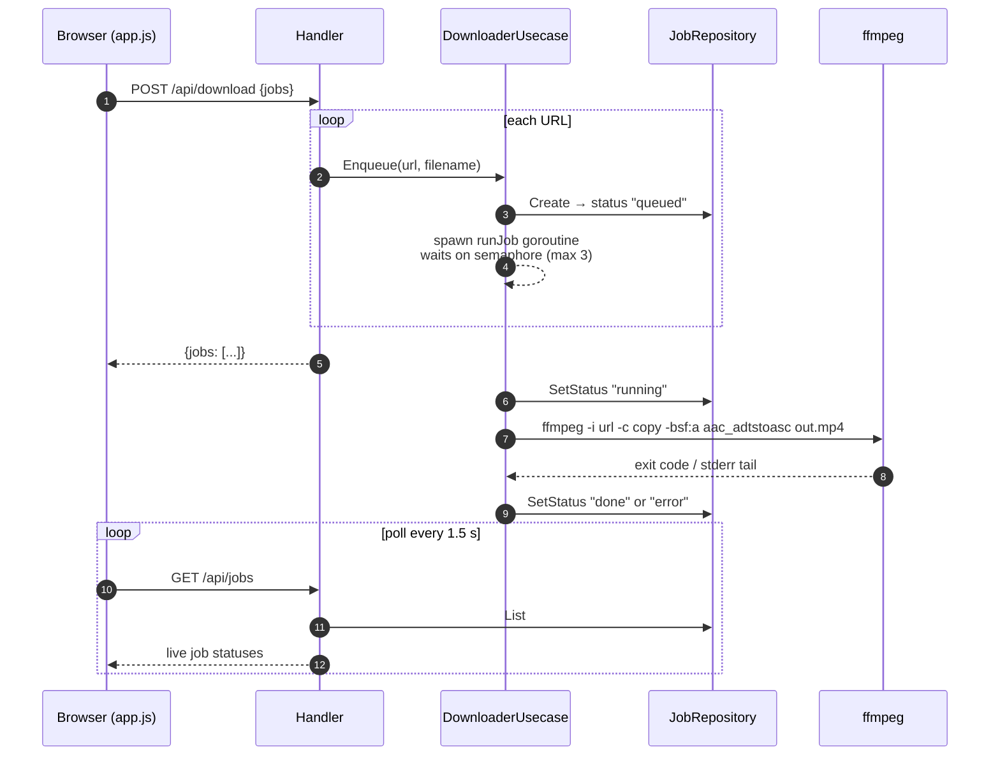
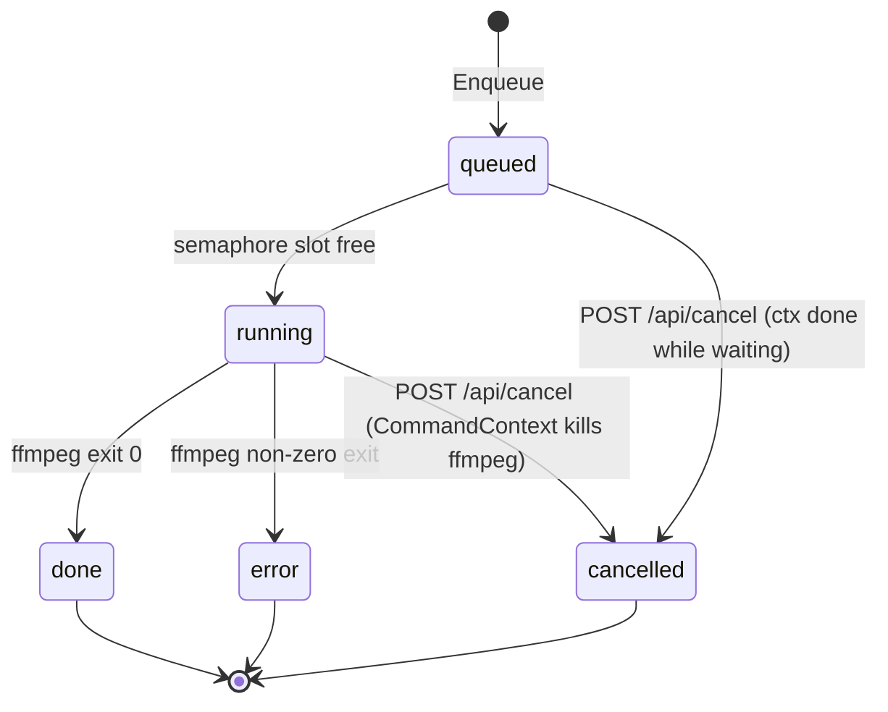

# HLS Downloader

A small web application to download HLS (`.m3u8`) video streams and save them as MP4 files using `ffmpeg`.

## Features

- Paste one or more m3u8 URLs and download them concurrently (max 3 ffmpeg workers at once; the rest stay queued)
- Cancel queued or running jobs — ffmpeg is killed immediately, no zombie processes
- Dynamic input rows — add/remove as many URL + filename pairs as needed
- Automatic filename sanitization: spaces and special characters become `_`, then a `_ffmpeg.mp4` suffix is appended
- Live job status (queued / running / done / error) with error details from ffmpeg
- Output saved to `$OUTPUT_DIR` (default `~/Documents/test`)
- Memory-safe: bounded job history and bounded ffmpeg log capture
- Docker deployment ready — `Dockerfile` + `docker-compose.yml` included

## Prerequisites

- **Go** 1.26+ (any recent version works)
- **ffmpeg** installed and on `PATH`

```bash
# macOS
brew install ffmpeg
```

## Run

```bash
go build -o hls-downloader ./cmd
./hls-downloader

# optionally override the output directory
OUTPUT_DIR=~/Movies ./hls-downloader
```

Then open **http://localhost:6969** in your browser.

## Docker

```bash
docker compose up --build
```

Then open **http://localhost:6969**. Downloaded files land in `./downloads` on the host — override the host side with:

```bash
HOST_OUTPUT_DIR=/path/on/host docker compose up
```

Or with plain Docker:

```bash
docker build -t hls-downloader .
docker run -p 6969:6969 -e OUTPUT_DIR=/downloads -v "$PWD/downloads:/downloads" hls-downloader
```

## Makefile

Common tasks are wrapped in a `Makefile` (`make help` lists them):

| Command             | Action                                 |
|---------------------|----------------------------------------|
| `make build`        | Compile `./hls-downloader` from `cmd/` |
| `make run`          | Build and start the server             |
| `make test`         | Run tests                              |
| `make vet` / `fmt`  | `go vet` / `gofmt`                     |
| `make docker-build` | `docker build -t hls-downloader .`     |
| `make docker-up`    | `docker compose up --build -d`         |
| `make docker-down`  | `docker compose down`                  |
| `make docker-logs`  | Tail container logs                    |
| `make clean`        | Remove the built binary                |

Override the output dir with `OUTPUT_DIR=~/Movies make run`.

## Usage

1. Enter an **m3u8 URL** (required) and a **file name** (optional — defaults to `video`).
2. Click **+ Add another** to queue multiple downloads; all run in parallel.
3. Click **Start Download**. The Jobs panel shows live progress status.
4. Finished files appear in the output directory (`$OUTPUT_DIR`, default `~/Documents/test`) as `<name>_ffmpeg.mp4`.

Example: `My Movie (2024)!` → `My_Movie_2024_ffmpeg.mp4`

## Architecture

The app follows a clean-architecture layout. `cmd/main.go` wires the layers together and serves the UI from `public/`; `internal/handlers` only parses HTTP requests and serializes JSON; `internal/usecases` holds all business logic (job orchestration, semaphore, ffmpeg execution); `internal/repositories` owns in-memory job state; `internal/entities` defines the shared `Job` type.



### Download lifecycle



### Job status transitions



## API

| Method | Endpoint        | Body / Response                                        |
|--------|-----------------|--------------------------------------------------------|
| GET    | `/`             | Web UI (static files)                                  |
| POST   | `/api/download` | `{"jobs":[{"url":"...m3u8","filename":"name"}, ...]}`  |
| GET    | `/api/jobs`     | `{"jobs":[{id,url,filename,status,error,started_at}],"output_dir":"..."}` |
| POST   | `/api/cancel`   | Query: `?id=job-N` — cancels a queued/running job    |
| GET    | `/api/memstats` | `{heap_alloc,heap_sys,sys,num_gc,goroutines}`        |

Example:

```bash
curl -X POST http://localhost:6969/api/download \
  -H "Content-Type: application/json" \
  -d '{"jobs":[{"url":"https://example.com/stream.m3u8","filename":"my video"}]}'
```

## How it works

Each job runs the equivalent of:

```bash
ffmpeg -y -i "<m3u8-url>" -c copy -bsf:a aac_adtstoasc "<name>_ffmpeg.mp4"
```

`-c copy` remuxes without re-encoding (fast, lossless); `aac_adtstoasc` converts the audio bitstream for the MP4 container.

## Configuration

| What                | Where                                                |
|---------------------|------------------------------------------------------|
| Port                | `cmd/main.go` — `addr := ":6969"`                    |
| Output directory    | `OUTPUT_DIR` env var (default `~/Documents/test`) — `resolveOutputDir()` |
| Retained job history| `internal/repositories/job_repository.go` — `maxFinishedJobs` |
| Parallel downloads  | `internal/usecases/downloader.go` — `maxConcurrentDownloads`  |

## Project structure

```
hls-downloader/
├── cmd/
│   └── main.go                      # Entrypoint: wiring + HTTP server
├── internal/
│   ├── entities/
│   │   └── job.go                   # Job domain type
│   ├── repositories/
│   │   └── job_repository.go        # In-memory job store + eviction
│   ├── usecases/
│   │   └── downloader.go            # ffmpeg runner, semaphore, cancel
│   └── handlers/
│       └── handlers.go              # HTTP handlers
├── public/
│   ├── index.html                   # UI markup
│   ├── style.css                    # UI styles
│   └── app.js                       # Dynamic inputs + status polling
├── Makefile                       # build/run/test/docker task shortcuts
├── Dockerfile                     # Multi-stage: Go build + Alpine + ffmpeg
├── docker-compose.yml             # Port, OUTPUT_DIR env and volume mapping
├── .dockerignore
├── go.mod
└── README.md
```
